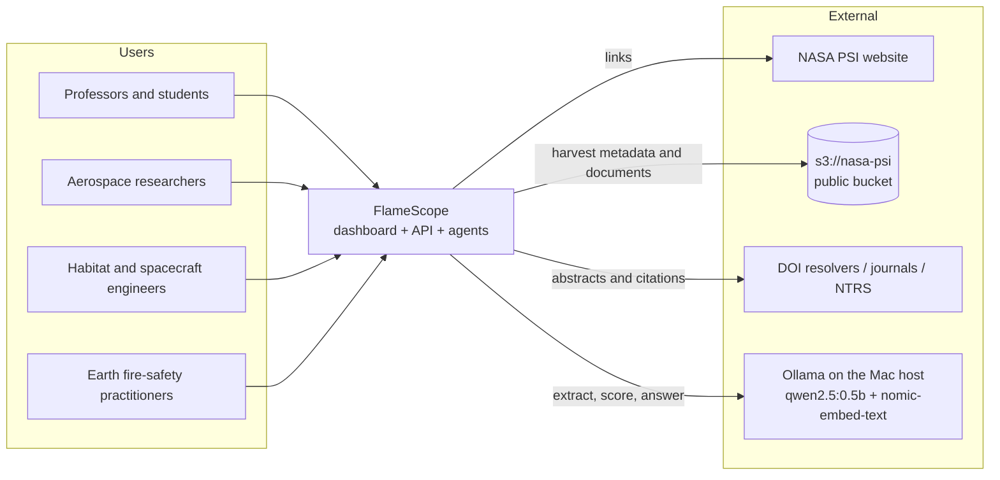
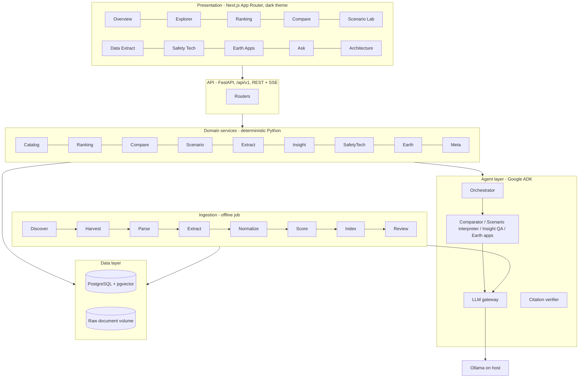

# 02 - System Architecture

## 1. System context



FlameScope reads from PSI; it never writes to it. The only calls that leave the containers at request time go to Ollama on the Mac host (Ask, comparison narrative, scenario explanation); nothing leaves the machine. In mock mode there are no such calls at all.

## 2. Logical architecture



### Layer rules (binding)

1. The UI talks only to the API, through the Next.js rewrite `/api/*` to the API container. It never talks to the database or the LLM.
2. Routers contain no business logic: validate, call one service, shape the response.
3. Services are deterministic. A service may call the agent orchestrator only where documents 05 and 09 say so (compare narrative, scenario explanation, ask).
4. Services reach the database only through repositories.
5. Agents never write to the database at request time. Only the ingestion pipeline writes catalog data.
6. All model and embedding access goes through the LLM gateway, which supplies the Google ADK model each agent runs on. Only `flamescope_common/llm/providers/` imports LiteLLM or calls Ollama; ADK agent and runner classes are imported only in `flamescope_agents`.
7. Every agent output is validated against a Pydantic schema before use. Free text is accepted only in fields that also carry source references.

## 3. Technology choices

| Concern | Choice | Notes |
|---------|--------|-------|
| UI | Next.js (App Router), TypeScript strict, Tailwind CSS, shadcn/ui, TanStack Query, Recharts, `@xyflow/react`, Mermaid | Dark theme only. Use the current stable major versions at build time and pin them in `package.json`. |
| API | Python 3.12, FastAPI, Uvicorn, Pydantic v2 | OpenAPI generated at `/api/v1/openapi.json`. |
| Persistence | PostgreSQL 16 with pgvector, SQLAlchemy 2.x, Alembic; Python packages `psycopg` (driver), `pgvector` (SQLAlchemy vector type), `alembic` | Image `pgvector/pgvector:pg16`. |
| Search | Hybrid: PostgreSQL full-text (`tsvector`) plus pgvector cosine | Reciprocal rank fusion. |
| Ingestion | Typer CLI, boto3 with unsigned requests, httpx, pypdf and pdfplumber, openpyxl (XLSX tables), pyyaml (seed, rubric, presets and override files) | Runs as a one-shot container. |
| Agents | Google ADK (`google-adk`): `LlmAgent`, `Runner`, `InMemorySessionService`; LiteLLM for the Ollama model adapter | One ADK `LlmAgent` per runtime agent, no tools (document 07). |
| LLM | Ollama running natively on the Mac host: chat model `qwen2.5:0.5b`, embedding model `nomic-embed-text` (768 dimensions); deterministic `mock` provider | Selected by `LLM_PROVIDER` (`ollama` default in `.env.example`, `mock` in tests). |
| Packaging | One root `pyproject.toml`; four Python packages under `src/` | `pip install -e ".[dev]"`. |
| Containers | Docker, Docker Compose v2 | Mac is the reference host. |
| Orchestration | GNU Make (macOS default 3.81 compatible) | Document 11. |
| Tests | pytest, pytest-asyncio, pytest-html (HTML report), respx, Playwright for Python, Vitest + Testing Library, `@vitest/coverage-v8` (pinned to the Vitest version) | Document 12. |
| Decks | `python-pptx` (optional extra `docs`, not a runtime dependency) | Builds and verifies the generated decks in `docs/decks/`: `pip install -e ".[docs]"`, then `python docs/decks/build_pitch.py`. |
| Quality | ruff, mypy, ESLint, `tsc --noEmit`, radon and xenon (complexity) | Cyclomatic complexity grade B or better per function (xenon `--max-absolute B --max-modules A --max-average A`), maintainability index grade A; ruff `C901` / `PLR` and ESLint `complexity`, `max-depth`, `max-params` rules. |

## 4. Repository layout (binding)

```
flamescope/
  Makefile
  pyproject.toml
  .env.example
  .gitignore
  README.md
  docs/
    architecture/            # these documents
    design-diagrams/         # draw.io
    decks/                   # pitch and demo decks (generated), their build scripts and screens/
  prompts/                   # numbered build prompts
  src/
    common/flamescope_common/        # settings, db, models, schemas, llm gateway, rubric
    agents/flamescope_agents/        # agents, orchestrator, runtime prompt files
    api/flamescope_api/              # FastAPI app: routers, services, repositories
    ingest/flamescope_ingest/        # pipeline and CLI
    ui/                              # Next.js application
    data/                            # seed files, rubric.yaml, presets.yaml, overrides/
  tests/
    unit/  integration/  e2e/
  deploy/
    docker/                  # Dockerfile.api, Dockerfile.ingest, Dockerfile.ui, compose.yaml
    helm/flamescope/         # optional Kubernetes / OpenShift chart
```

Nothing executable lives outside `src/`, `tests/` and `deploy/`, with one exception: the Python build and verification scripts of the generated decks live next to the decks in `docs/decks/` (for example `build_pitch.py` and `verify_pitch.py`). They are documentation tooling, are never imported by the application, and need only the `docs` extra.

## 5. Runtime topology

| Container | Image built from | Port | Depends on |
|-----------|------------------|------|------------|
| `db` | `pgvector/pgvector:pg16` | 5432 (localhost only) | - |
| `api` | `deploy/docker/Dockerfile.api` | 8000 | `db` healthy |
| `ingest` | `deploy/docker/Dockerfile.ingest` | - (one-shot) | `db` healthy |
| `ui` | `deploy/docker/Dockerfile.ui` | 3000 | `api` healthy |

Compose project name: `flamescope`. Volumes: `flamescope_pgdata`, `flamescope_raw`.

## 6. Cross-cutting concerns

- **Configuration**: `flamescope_common.config.Settings` (pydantic-settings). Full variable list in document 11.
- **Logging**: structlog JSON; fields `ts`, `level`, `logger`, `request_id`, `event`. The API accepts and returns `X-Request-ID`.
- **Errors**: one error envelope (document 05, section 2). Domain errors derive from `flamescope_common.errors.FlameScopeError`.
- **Provenance**: `SourceRef` objects (document 04, section 3) accompany every extracted field, score and generated claim.
- **Determinism**: with `LLM_PROVIDER=mock` all outputs are reproducible; the mock provider derives responses from a hash of the prompt and from fixtures.
- **Security**: no authentication (public read-only demo). CORS limited to `CORS_ORIGINS`. The API never returns secrets or environment values. SQL only through SQLAlchemy.

## 7. Architecture decisions

| ID | Decision | Reason | Consequence |
|----|----------|--------|-------------|
| ADR-01 | Curate metadata and documents; link to raw data. | 12 TB cannot be moved or processed in a hackathon; insight is in overviews, documents and papers. | The Data Extract view offers condition and outcome tables, not raw sensor streams. |
| ADR-02 | Do LLM extraction and scoring offline at ingestion. | Fast, reproducible UI; results can be reviewed and corrected. | Changing the rubric requires re-running the score stage. |
| ADR-03 | Ranking arithmetic is deterministic and user-tunable. | Trust and explainability; no hidden model judgment at query time. | The scorer agent only rates criteria 0 to 5 with evidence. |
| ADR-04 | Two ingestion modes: `seed` and `harvest`. | Offline demo and tests need no network or LLM. | Seed YAML files are first-class artifacts kept in `src/data/seed/`. |
| ADR-05 | PostgreSQL with pgvector for both relational and vector data. | One store, one backup, simple compose stack. | Embedding dimension is fixed per database. |
| ADR-06 | Next.js for the UI with a server-side rewrite to the API. | Required by the brief; avoids CORS and exposes one origin. | `API_INTERNAL_URL` configures the rewrite target. |
| ADR-07 | LLM gateway with a mock provider. | Tests and the fallback demo must not depend on a live model. | Every agent must work under the mock provider: `MockLlm` synthesizes schema-valid output for every agent; fixtures are optional (document 07 section 6). |
| ADR-08 | Partial gravity is presented as a bounded gap, never interpolated into a number. | The data does not exist; inventing values would mislead. | Scenario results carry a `gravity_bounding` block. |
| ADR-09 | Docker Compose is the primary deployment; Helm is optional. | Mac laptop is the reference host. | Makefile targets wrap compose; `helm-*` targets are separate. |
| ADR-10 | The Architecture page renders from JSON in `src/ui/content/architecture/` that mirrors these documents. | Diagram is part of the product and must stay in step with the design. | A conformance test checks node IDs against document 03 component IDs. |
| ADR-11 | Runtime agents are Google ADK `LlmAgent`s; live mode uses Ollama on the Mac host with `qwen2.5:0.5b` (chat) and `nomic-embed-text` (embeddings). | Owner decision 2026-11-12: a standard agent framework and a fully local, free, offline-capable model. Ollama runs natively so it can use the Mac GPU. | Providers are `mock` and `ollama` only; containers reach Ollama at `host.docker.internal:11434`; a 0.5B model gives weaker extraction and narratives, contained by schema validation, retries and the citation verifier. `LLM_MODEL` can name a larger model without code change. |
