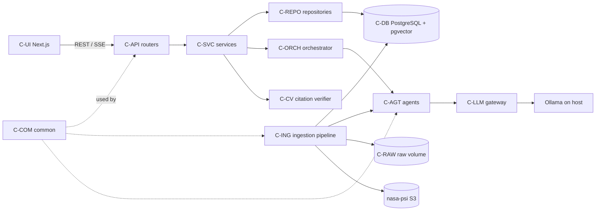

# 03 - Component Design

Each component has an ID, a location, a responsibility, its public interface, and what it may depend on. Module and class names here are binding.

## 1. Component map

## 2. C-COM - common library

Location: `src/common/flamescope_common/`

| Module | Contents |
|--------|----------|
| `config.py` | `Settings` (pydantic-settings), `get_settings()` cached. |
| `logging.py` | `configure_logging()`, request-ID context variable. |
| `errors.py` | `FlameScopeError` and subclasses `NotFoundError`, `ValidationError`, `LLMError`, `IngestError`. Each class carries the envelope `code` of document 05 section 2: `NotFoundError` is `not_found` (404); `ValidationError` is `bad_request` (400) and covers semantically invalid input raised by services; `LLMError` is `llm_unavailable` (502). Schema validation of requests is not a domain error: the API maps FastAPI request validation to `validation_error` (422) itself. |
| `db.py` | `engine`, `SessionLocal`, `get_session()`; sync SQLAlchemy 2.x sessions. |
| `models.py` | ORM models for every table in document 04. |
| `migrations/` + `alembic.ini` | Alembic environment; revision `0001_initial` creates the schema and the `vector` extension. |
| `sources.py` | `SourceRef` Pydantic model and helpers. |
| `schemas/card.py` | `InvestigationCard` and nested models (document 04, section 4); unknown keys are ignored. `SeedInvestigation(InvestigationCard)` adds the seed-only keys (`psi_url`, `summary`, `runs`, `scores`, `documents`, `reviewed`) with `SeedRun`, `SeedScore`, `SeedDocument` (document 06, section 5). |
| `schemas/api.py` | Request and response models for document 05, including `PageRequest` (`page`, `page_size`, `sort`; the pagination and sort query of list endpoints, document 05 section 1 and 4). |
| `schemas/agents.py` | Input and output models for every agent (document 07). |
| `units.py` | Unit conversion: psi to kPa, percent to fraction, mm/s and cm/s, gravity labels to g. |
| `rubric.py` | `Rubric` loader and validator for `src/data/rubric.yaml`; `Presets` loader for `presets.yaml`. |
| `llm/gateway.py` | `LLMGateway` with `model()` (the Google ADK model for the configured provider), `embed()`, `callbacks()` (ADK before/after model callbacks for cache, logging and request ID). |
| `llm/providers/mock.py`, `ollama.py` | Provider adapters behind one protocol `LLMProvider`: `MockLlm` (ADK `BaseLlm`, deterministic) and Ollama (ADK `LiteLlm` with `ollama_chat/<LLM_MODEL>`, embeddings via `/api/embed`). `mock.py` holds `MockLlm`, `MockProvider`, `hashed_embedding`, request parsing, the generic schema fallback and the fixture lookup. |
| `llm/providers/mock_agents.py` | The rule-based synthesizers behind `MockLlm`: one deterministic, schema-valid answer per agent contract (document 07). Split from `mock.py` to keep both modules within the maintainability limit. |
| `llm/cache.py` | Database-backed response cache keyed by SHA-256 of provider, model, prompt and parameters. |

Depends on: nothing inside the project.

## 3. C-AGT / C-ORCH / C-CV - agents

Location: `src/agents/flamescope_agents/`

| Module | Class | Used by | Purpose |
|--------|-------|---------|---------|
| `base.py` | `Agent` | all agents | Loads its prompt file, renders variables, builds a Google ADK `LlmAgent` (model from the gateway, `output_schema` from its output model, no tools), validates JSON, retries up to 2 times on schema failure. |
| `orchestrator.py` | `AgentOrchestrator` | services, ingest | Registry of agents by name; constructor `AgentOrchestrator(gateway=None, settings=None, agents=None)`; `run(name, payload, *, stream=False)` through an ADK `Runner` with `InMemorySessionService` (one throwaway session per call): `await run(...)` returns the validated output model (a `str` for Insight QA), `run(..., stream=True)` returns an `AsyncIterator[str]` of text deltas, sync callers (ingest) use `asyncio.run(...)`; `prompt_version(name)` (for example `scorer@1`) and `agent_names()`; attaches request ID; measures latency (document 07 section 5). |
| `extractor.py` | `ExtractorAgent` | ingest | Parsed document sections to `InvestigationCard` draft with per-field sources and confidence. |
| `scorer.py` | `ScorerAgent` | ingest | Card plus excerpts to criterion values 0 to 5 with rationale and evidence. |
| `comparator.py` | `ComparatorAgent` | CompareService | Diff matrix to short cited narrative. |
| `scenario_interpreter.py` | `ScenarioInterpreterAgent` | ScenarioService | Matches and coverage to cited interpretation and caveats. |
| `insight_qa.py` | `InsightQAAgent` | InsightService | Question plus retrieved chunks to answer with chunk-ID citations (streamed). |
| `earth_apps.py` | `EarthAppsAgent` | ingest (`review.py`, harvest mode) | Findings to candidate Earth applications, written to `/data/raw/<acronym>/earth_candidates.json` for curation into `earth_applications.yaml`; never stored in the database. |
| `citation_verifier.py` | `CitationVerifier` | InsightService, CompareService, ScenarioService | Deterministic check that each cited sentence is supported by its cited chunk; drops or flags unsupported sentences. |
| `prompts/*.md` | - | agents | One runtime prompt file per agent (document 07). |

Depends on: C-COM and Google ADK (`google-adk`).

## 4. C-API - routers

Location: `src/api/flamescope_api/`

| Module | Router prefix | Endpoints (document 05) |
|--------|---------------|-------------------------|
| `main.py` | - | App factory `create_app()`, middleware (request ID, CORS, error handlers), router registration under `/api/v1`. |
| `deps.py` | - | Dependency providers: session, settings, repositories, services, orchestrator. |
| `errors.py` | - | Exception handlers producing the error envelope. |
| `sse.py` | - | `sse_event(event, data)` formatter and streaming response helper. |
| `routers/health.py` | `/health`, `/ready` | Liveness and readiness. |
| `routers/meta.py` | `/meta` | `stats`, `status`, `rubric`, `presets`. |
| `routers/investigations.py` | `/investigations` | List, detail, runs, publications, variables. |
| `routers/catalog.py` | `/facets`, `/hardware`, `/projects` | Facets and lineage. |
| `routers/rank.py` | `/rank` | Rank. |
| `routers/compare.py` | `/compare` | Compare. |
| `routers/scenario.py` | `/scenario` | Scenario match. |
| `routers/extract.py` | `/extract` | Preview, export, dictionary. |
| `routers/insights.py` | `/insights` | Safety tech, gaps. |
| `routers/earth.py` | `/earth-applications` | Earth applications. |
| `routers/ask.py` | `/ask` | SSE question answering. |

## 5. C-SVC - domain services

Location: `src/api/flamescope_api/services/`

| Module / class | Public methods | Depends on | LLM at request time |
|----------------|----------------|------------|---------------------|
| `catalog.py` / `CatalogService` | `list(filters, page)`, `get(id)`, `runs(id, page)`, `variables(id)`, `publications(id)`, `facets()`, `hardware_lineage()`, `projects()` | InvestigationRepo, RunRepo, RankingService (summaries carry scores, CF-04) | No |
| `ranking.py` / `RankingService` | `rank(lens, weights, preset, filters)`, `breakdown(id)`, `score_sets(ids=None)` (default-weight scores per investigation for summaries) | ScoreRepo, Rubric, Presets | No |
| `compare.py` / `CompareService` | `compare(ids, narrative)` | InvestigationRepo, RankingService, Orchestrator (optional), CitationVerifier | Only if `narrative=true` |
| `scenario.py` / `ScenarioService` | `match(scenario, explain)`; module functions `resolve_scenario(request, presets)`, `scenario_id_of(scenario)`, `scenario_from_id(scenario_id)` (the stateless, invertible `scenario_id` of document 05 section 7) | RunRepo, InvestigationRepo, Presets, Orchestrator (optional), CitationVerifier | Only if `explain=true` |
| `scenario_math.py` | Pure scenario maths of document 08 section 4: `distance`, `dimension_distances`, `coverage`, `gravity_bounding`, `score_runs`, `rank_matches`, `matching_runs`. Split from `scenario.py` to keep both modules within the maintainability limit; `scenario.py` re-exports `distance`, `coverage` and `gravity_bounding`, so `scenario.<name>` below still resolves. | `RunRecord` (row model of RunRepo), `catalog.to_run_item` | No |
| `extract.py` / `ExtractService` | `preview(query)`, `export(query, format)`, `dictionary()` | RunRepo, Rubric (`rubric_version` in the export header) | No |
| `insight.py` / `InsightService` | `ask(question, filters, top_k)` (async generator of SSE events) | ChunkRepo, InvestigationRepo, Orchestrator, CitationVerifier, LLMGateway (embedding) | Yes |
| `safety_tech.py` / `SafetyTechService` | `grouped()`, `gaps()` | InvestigationRepo, RunRepo (parameter-space gaps) | No |
| `earth.py` / `EarthService` | `list(sector)` | EarthRepo | No |
| `meta.py` / `MetaService` | `stats()`, `status()`, `ready()` (readiness report for `/ready`) | InvestigationRepo (counts, last ingest run, schema revision, ping), Settings, Rubric, LLMGateway | No |

`page` is the `PageRequest` model of `schemas/api.py` (`page`, `page_size`, `sort`). For `POST /rank` the router applies `limit` to the ranked list; `rank` returns every matching investigation. In `ExtractService`, `query.limit` bounds the preview only; `export` returns every matching run.

Pure functions that must be unit-tested in isolation (documented call shapes first; the optional trailing parameters carry what the formulas of document 08 need and have defaults so the short call shapes still work):

- `ranking.aggregate(criterion_scores, weights, labels=None) -> LensScore` (unrounded floats; rounding happens when responses are shaped; `labels` maps criterion IDs to display labels)
- `scenario.distance(scenario, condition, ranges, weights, material_class=None) -> float` (`material_class` is the class of the scenario fuel, for the 0.3 rule of document 08 section 4.2)
- `scenario.coverage(scenario, ranges, gravity_values=()) -> dict[str, CoverageState]` (`gravity_values` are the catalog gravity values, document 08 section 4.3)
- `scenario.gravity_bounding(scenario, runs, *, top_acronyms=None, analogue=None, statement=None) -> GravityBounding` (top matches, the `partial_gravity_analogue` investigation and the `texts.gravity_bounding` statement, document 08 section 4.4)
- `compare.diff_matrix(cards) -> DiffMatrix`
- `extract.build_table(runs, columns) -> Table`
- `insight.fuse_ranks(keyword_hits, vector_hits, k=60) -> list[ChunkHit]` (`k` is the reciprocal-rank-fusion constant; truncation to `top_k` is the caller's)

## 6. C-REPO - repositories

Location: `src/api/flamescope_api/repositories/`

| Module / class | Methods |
|----------------|---------|
| `investigations.py` / `InvestigationRepo` | `search(filters, page)`, `get(id_or_acronym)`, `by_ids(ids)`, `facet_counts()`, `findings(category, acronyms=None)`, `hardware_links()`, `publications(id)`, `measurements(id)`, `projects()` (each project with its member acronyms), `stats()` (corpus counts and ranges for `/meta/stats`), `last_ingest_run()`, `schema_revision()` (Alembic revision), `ping()` (database reachable) |
| `runs.py` / `RunRepo` | `for_investigation(id)`, `query(filters)`, `condition_ranges()` (catalog range per dimension, widened by aggregate run ranges, document 08 section 4.2). Rows are `RunRecord`s whose `span_of(dimension)` gives the stated range of an aggregate run or the single value as a point. |
| `scores.py` / `ScoreRepo` | Constructed as `ScoreRepo(session, rubric_version)`; reads only scores of the current rubric version. `all_scores(filters)`, `for_investigation(id)` |
| `chunks.py` / `ChunkRepo` | `keyword_search(q, k, filters)`, `vector_search(embedding, k, filters)`, `by_ids(ids)` |
| `earth.py` / `EarthRepo` | `list(sector)` |

Repositories return ORM objects or lightweight row models; services convert to API schemas.

## 7. C-ING - ingestion pipeline

Location: `src/ingest/flamescope_ingest/`

| Module | Stage / role |
|--------|--------------|
| `cli.py` | Typer app `flamescope-ingest` with commands `migrate`, `seed`, `discover`, `harvest`, `run`, `score`, `index`, `review`, `export-seed`, `status` (document 06 section 4). |
| `pipeline.py` | `Pipeline.run(investigation_ids, stages)`; stage ordering; `ingest_run` audit rows. |
| `discover.py` | Lists the S3 bucket under `PSI_PREFIX`; writes `manifest.json` per investigation. |
| `harvester.py` | Downloads overview, documents and small tabular files within size limits. |
| `parser.py` | HTML, PDF, CSV, XLSX to `ParsedDoc` with sections and offsets; records units detected in table headers (`ParsedTable.units`). |
| `extract_stage.py` | Calls `ExtractorAgent`; merges overrides. |
| `normalizer.py` | Fuel taxonomy, tag vocabulary, aggregate runs; values already arrive in canonical units, so no unit conversion (document 06 section 3.5). |
| `linker.py` | Projects, hardware, instruments, publications (DOIs). |
| `score_stage.py` | Calls `ScorerAgent`; writes `relevance_score`. |
| `embedder.py` | Chunking and embeddings. |
| `loader.py` | Idempotent upserts for every table. |
| `seed.py` | Loads `src/data/seed/**` (no network, no LLM unless scores are missing). |
| `overrides.py` | Applies `src/data/overrides/<acronym>.yaml`. |
| `review.py` | Lists low-confidence or conflicting fields; in harvest mode calls `EarthAppsAgent` through the orchestrator and writes `earth_candidates.json` to the raw volume. |

Depends on: C-COM, C-AGT. Never imports from `flamescope_api`.

## 8. C-UI - Next.js application

Location: `src/ui/`. Detailed in document 10. Summary of internal components:

| Area | Path | Role |
|------|------|------|
| Routes | `app/(dashboard)/<route>/page.tsx` | One per view. |
| API client | `lib/api/client.ts`, `lib/api/types.ts`, `lib/api/hooks.ts` | Typed fetch, SSE reader, TanStack Query hooks. |
| Design system | `components/ui/*`, `app/globals.css`, `tailwind.config.ts` | Tokens and primitives. |
| Domain components | `components/investigations/*`, `ranking/*`, `compare/*`, `scenario/*`, `extract/*`, `ask/*`, `architecture/*`, `charts/*` | View building blocks. |
| Architecture content | `content/architecture/*.json`, `content/architecture/flows/*.mmd` | Diagram data mirroring these documents. |
| State | `lib/store.ts` (Zustand) | Weights, selected investigations, filters. |

## 9. C-DB and C-RAW

- **C-DB**: PostgreSQL 16 with `vector` and `pg_trgm` extensions. Schema in document 04.
- **C-RAW**: volume mounted at `/data/raw` in `ingest` (read-write) and `api` (read-only). Layout `/data/raw/<acronym>/{manifest.json, raw/, parsed/, card.draft.json, card.json, earth_candidates.json}` (document 06 section 2).

## 10. Dependency rules (enforced by a unit test)

| From | May import |
|------|-----------|
| `flamescope_common` | standard library, third-party |
| `flamescope_agents` | `flamescope_common` |
| `flamescope_ingest` | `flamescope_common`, `flamescope_agents` |
| `flamescope_api` | `flamescope_common`, `flamescope_agents` |
| `flamescope_api.routers` | `flamescope_api.services`, `flamescope_api.deps`, schemas - never repositories or agents directly |
| `flamescope_api.services` | repositories, orchestrator, common - never routers |
