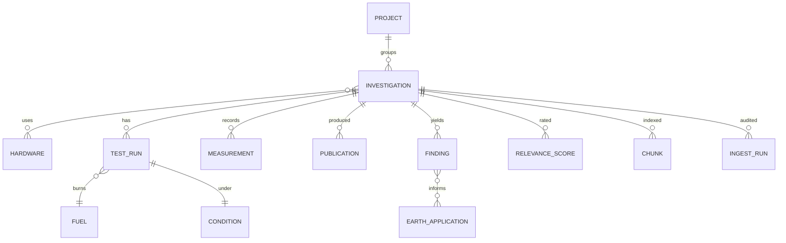

# 04 - Data Model

PostgreSQL 16, extensions `vector` and `pg_trgm`. All tables have `created_at` and `updated_at` (`timestamptz`, default `now()`). Primary keys are `bigint` identity unless stated. Enumerations are stored as `text` with check constraints.

## 1. Entity relationships



## 2. Tables

Nullability: in `investigation`, `test_run`, `condition` and `finding` a column marked `null` may be null and the others are not. Defaults are stated in the notes: JSON columns default to empty (`{}` or `[]`), arrays to empty, `reviewed` and `is_aggregate` to false, `discipline` to `combustion`. `confidence` has no default. Seed authors write `null` for an unknown `platform` or `gravity_level`.

### project
| Column | Type | Notes |
|--------|------|-------|
| id | bigint PK | |
| name | text unique | for example `ACME` |
| description | text | |

### hardware
| Column | Type | Notes |
|--------|------|-------|
| id | bigint PK | |
| name | text unique | `CIR`, `MSG`, `MDCA`, `ACME insert`, `SPICE flow duct`, instruments |
| kind | text | `facility`, `apparatus`, `insert`, `instrument` |
| description | text | |
| parent_id | bigint FK hardware | for example MDCA inside CIR |

### investigation
| Column | Type | Notes |
|--------|------|-------|
| id | bigint PK | |
| acronym | text unique | URL key, for example `BASS-II` |
| title | text | |
| discipline | text | default `combustion` |
| project_id | bigint FK project null | |
| psi_url | text null | PSI page; interim and harvest values in document 06 sections 3.1 and 5 |
| s3_prefix | text null | |
| platform | text null | `ISS`, `drop_tower`, `parabolic`, `sounding_rocket`, `suborbital`, `ground`; null when no source states it |
| gravity_level | text null | `microgravity`, `normal`, `partial`, `mixed`; null when no source states it |
| years | int4range null | |
| status | text null | `completed`, `ongoing`, `planned`; not in the seed format |
| objectives | jsonb | array of `{text, source}`; default `[]` |
| approach | text null | |
| summary | text null | 2 to 4 sentences, curated |
| fuel_phases | text[] | derived: `gas`, `liquid`, `solid`; default empty |
| fire_safety_tags | text[] | controlled vocabulary (section 5); default empty |
| o2_min, o2_max | numeric null | fraction 0 to 1, derived from runs or stated ranges: the extent of the stated ranges, aggregate-run ranges and run values; a null endpoint of any half-open range keeps that side null (open, document 08 section 4.2), for example `o2_min = null`, `o2_max = 0.85` for a card stated as `[null, 0.85]` (in the seed set BASS-II flow, `flow_min_cm_s = null`, `flow_max_cm_s = 55`); both null means no data |
| pressure_min_kpa, pressure_max_kpa | numeric null | same derivation and null rule as `o2_min`, `o2_max` |
| flow_min_cm_s, flow_max_cm_s | numeric null | same derivation and null rule as `o2_min`, `o2_max` |
| data_volume_bytes | bigint null | from manifest |
| file_manifest_ref | text null | path under `/data/raw` |
| card | jsonb | full `InvestigationCard` (section 4) |
| card_version | int | default 1; increments on change |
| reviewed | boolean | curator has checked the card; default false |
| search_tsv | tsvector | generated from title, summary, objectives |

Indexes: GIN on `search_tsv`, GIN on `fire_safety_tags`, GIN on `fuel_phases`, trigram on `acronym` and `title`.

### investigation_hardware
`investigation_id` FK, `hardware_id` FK, `role` text (`host`, `apparatus`, `instrument`); PK on the pair.

### fuel
| Column | Type | Notes |
|--------|------|-------|
| id | bigint PK | |
| name | text | `PMMA`, `n-heptane`, `methane`, `cotton-fiberglass (SIBAL)` |
| phase | text | `gas`, `liquid`, `solid` |
| material_class | text null | `polymer`, `fabric`, `alkane`, `alcohol`, `hydrocarbon gas`, ... |
| unique (name, phase) | | |

### test_run
| Column | Type | Notes |
|--------|------|-------|
| id | bigint PK | |
| investigation_id | bigint FK | |
| label | text | sample or test point name |
| fuel_id | bigint FK fuel null | |
| geometry | jsonb | `{shape, dimensions_mm:{...}, burner}`; default `{}` |
| varied_parameters | jsonb | names and values that change within the investigation; default `{}` |
| fixed_parameters | jsonb | default `{}` |
| outcome | jsonb | `{ignited, flame_spread_rate_mm_s, burn_rate, extinction, smoke_point, cool_flame, notes}`; any key may be null; default `{}` |
| data_files | jsonb | array of `{s3_key, bytes, type}`; default `[]` |
| source | jsonb | `SourceRef` |
| confidence | numeric | 0 to 1 (checked); required, no default |
| is_aggregate | boolean | true when the row represents a stated range rather than one test; default false |

### condition
One row per test run (`test_run_id` PK and FK).

| Column | Type | Notes |
|--------|------|-------|
| o2_fraction | numeric null | 0 to 1 |
| diluent | text null | `N2`, `CO2`, `He`, ... |
| pressure_kpa | numeric null | |
| flow_speed_cm_s | numeric null | |
| flow_direction | text null | `opposed`, `concurrent`, `quiescent`, `coflow` |
| gravity_g | numeric null | 0 for microgravity, 1 for normal |
| e_field_kv | numeric null | |
| temperature_k | numeric null | |
| source | jsonb | `SourceRef` |

### measurement
`id`, `investigation_id` FK, `instrument` text, `hardware_id` FK null, `quantity` text, `units` text null, `file_pattern` text null, `notes` text, `source` jsonb.

### publication
`id`, `investigation_id` FK, `doi` text null, `title`, `authors` text[], `year` int, `venue` text null, `abstract` text null, `url` text null, `key_findings` jsonb. Unique `(investigation_id, coalesce(doi, title))`.

### finding
| Column | Type | Notes |
|--------|------|-------|
| id | bigint PK | |
| investigation_id | bigint FK | |
| statement | text | one sentence |
| category | text | `detection`, `suppression`, `material_screening`, `post_fire`, `atmosphere_design`, `fundamental` |
| source | jsonb | `SourceRef` (required) |
| confidence | numeric | 0 to 1 (checked); required, no default |

### earth_application and finding_earth_application
`earth_application(id, title, sector, description, maturity, references jsonb)`; sector in `firefighting`, `detection`, `building_safety`, `industrial`, `wildfire`, `transport`. Link table `(finding_id, earth_application_id)`; an application may also link directly to investigations through `earth_application_investigation(earth_application_id, investigation_id)`. Rows come only from the curated `src/data/seed/earth_applications.yaml`; `EarthAppsAgent` candidates are never stored here (they stay in `/data/raw/<acronym>/earth_candidates.json` for curation, document 06 section 3.9).

### relevance_score
| Column | Type | Notes |
|--------|------|-------|
| id | bigint PK | |
| investigation_id | bigint FK | |
| lens | text | `habitat`, `modeling`, `controls` |
| criterion | text | IDs in document 08 |
| value | numeric null | 0 to 5; null means no evidence |
| rationale | text | |
| evidence | jsonb | array of `SourceRef` |
| rubric_version | text | |
| origin | text | `llm`, `seed`, `override` |
| unique (investigation_id, lens, criterion, rubric_version) | | |

### chunk
| Column | Type | Notes |
|--------|------|-------|
| id | bigint PK | |
| investigation_id | bigint FK | |
| doc_ref | text | file path or URL |
| doc_title | text | |
| section | text null | |
| char_start, char_end | int | offsets in parsed text |
| text | text | 800 to 1200 characters, 150 overlap |
| embedding | vector(EMBED_DIM) | |
| tsv | tsvector | generated |
| source | jsonb | `SourceRef` |

Indexes: HNSW on `embedding` (cosine), GIN on `tsv`.

### ingest_run
`id`, `investigation_id` FK null, `mode` (`seed`, `harvest`), `stages` text[], `status` (`ok`, `failed`, `partial`), `started_at`, `finished_at`, `report` jsonb (fields filled, fields null, review items, LLM calls, errors).

### llm_cache
`key` text PK (SHA-256), `provider`, `model`, `response` jsonb, `created_at`.

## 3. SourceRef

```json
{
  "kind": "psi_page | document | publication | s3_object | curated",
  "uri": "https://... or s3://nasa-psi/...",
  "title": "Science Requirements Document",
  "locator": "section 3.2 | page 14 | chars 10240-10980",
  "quote": "short supporting excerpt, at most 240 characters",
  "chunk_id": 1234
}
```

`kind` and `uri` are required. Allowed source URIs for curated facts: a PSI page (`psi_page`), a `s3://nasa-psi/` key (`s3_object`), a DOI URL (`publication`), or an `https` page on a NASA host (`nasa.gov` or any `*.nasa.gov` host): NASA Technical Reports Server records `https://ntrs.nasa.gov/citations/<id>` use kind `publication`, other NASA pages (for example `science.nasa.gov` investigation pages) use kind `document`. `curated` is allowed only in seed and override files and must still carry a `uri` to a PSI page or DOI, or, for the challenge facts of document 01 section 6, to the challenge page `https://www.spaceappschallenge.org/2026/challenges/flame-in-freefall/`. Validation (`sources.is_allowed_uri`) accepts any `https` URL with a host and any non-empty key under `s3://nasa-psi/`; the narrower kinds of URI are a curation rule (document 06 section 5).

## 4. InvestigationCard (JSON stored in `investigation.card`)

```json
{
  "schema_version": 1,
  "acronym": "BASS-II",
  "title": "Burning and Suppression of Solids - II",
  "project": null,
  "platform": "ISS",
  "gravity_level": "microgravity",
  "hardware": [{"name": "MSG", "role": "host"}, {"name": "SPICE flow duct", "role": "apparatus"}],
  "objectives": [{"text": "...", "source": {}}],
  "approach": {"text": "...", "source": {}},
  "fuels": [{"name": "PMMA", "phase": "solid", "material_class": "polymer",
             "geometry": {"shape": "rod", "dimensions_mm": {"diameter": 6.4}}, "source": {}}],
  "conditions": {
    "o2_fraction": {"min": 0.13, "max": 0.19, "source": {}},
    "pressure_kpa": {"min": 101.3, "max": 101.3, "source": {}},
    "flow_speed_cm_s": {"min": 2, "max": 48, "source": {}},
    "flow_direction": ["opposed", "concurrent"],
    "gravity_g": [0]
  },
  "variables": {"varied": ["o2_fraction", "flow_speed_cm_s", "sample thickness"], "fixed": ["pressure_kpa"]},
  "measurements": [{"instrument": "video camera", "quantity": "flame shape, spread rate", "source": {}}],
  "findings": [{"statement": "...", "category": "material_screening", "source": {}, "confidence": 0.8}],
  "publications": [{"doi": "10.xxxx/xxxx", "title": "...", "year": 2015,
                   "authors": [], "venue": null, "url": null, "key_findings": []}],
  "fire_safety_tags": ["flame_spread", "solid_fuel", "extinction"],
  "data": {"s3_prefix": "...", "volume_bytes": null, "file_types": []},
  "field_confidence": {"fuels": 0.9, "conditions": 0.6},
  "open_questions": ["pressure not stated in overview"]
}
```

Publication `authors`, `venue`, `url` and `key_findings` are optional (empty list or null by default) and feed `GET /investigations/{id}/publications` (document 05 section 4); `abstract` is not carried in the card. The numeric values in this example illustrate shape only; real values come from sources. Every leaf that states a fact carries a `source`. Unknown values are `null`, never guessed.

## 5. Controlled vocabularies

- **fire_safety_tags**: `ignition`, `flame_spread`, `flammability_limit`, `extinction`, `suppression`, `smoke_detection`, `aerosol`, `soot`, `cool_flame`, `droplet`, `solid_fuel`, `gaseous_fuel`, `liquid_fuel`, `high_oxygen`, `low_pressure`, `flow_effects`, `electric_field`, `partial_gravity_analogue`, `material_screening`, `post_fire`.
- **finding.category**: see table above.
- **coverage state**: `covered`, `extrapolated`, `no_data`.

## 6. Migration notes

- `0001_initial` creates everything above. `EMBED_DIM` is read at migration time; changing it later requires a new revision that drops and recreates `chunk.embedding` and re-runs the index stage.
- Derived columns on `investigation` (`fuel_phases`, `o2_min` and so on) are recomputed by `loader.py` after runs are upserted.
