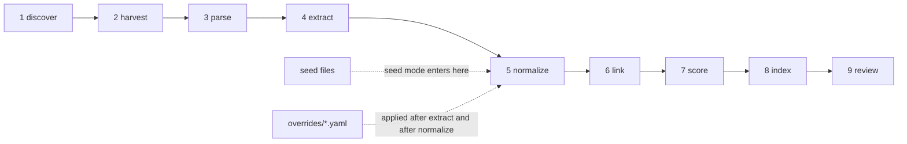

# 06 - Ingestion Pipeline

The pipeline fills the database. It runs as the `ingest` container or as the CLI `flamescope-ingest`. It is the only writer of catalog data.

## 1. Modes

| Mode | Network | LLM | Input | Use |
|------|---------|-----|-------|-----|
| `seed` | none | none (uses scores in seed files; missing scores are computed with the configured provider: `ollama` in a default deploy, `mock` in tests) | `src/data/seed/**` | Tests, offline demo, first bring-up. Deterministic. |
| `harvest` | S3 (public, unsigned), DOI lookups | required (`ollama`) | `s3://nasa-psi/<PSI_PREFIX>` | Real extraction; output can be exported back to seed files. |

`make deploy` runs `seed`. `make ingest-harvest` runs `harvest`. After a harvest, `flamescope-ingest export-seed` writes reviewed cards to `src/data/seed/investigations/` so the curated result becomes the offline dataset.

## 2. Stages



| # | Stage | Module | Input | Output artifact | Idempotency key |
|---|-------|--------|-------|-----------------|-----------------|
| 1 | discover | `discover.py` | bucket, prefix | `/data/raw/_index/investigations.json`; per investigation `manifest.json` (keys, sizes, types, last-modified) | bucket listing ETag set |
| 2 | harvest | `harvester.py` | manifest | `/data/raw/<acr>/raw/*` for allowed files | S3 ETag per key |
| 3 | parse | `parser.py` | raw files | `/data/raw/<acr>/parsed/<doc>.json` (`ParsedDoc`) | SHA-256 of raw file |
| 4 | extract | `extract_stage.py` | parsed docs | `/data/raw/<acr>/card.draft.json` | hash of parsed docs + prompt version |
| 5 | normalize | `normalizer.py` | draft card or seed card | `/data/raw/<acr>/card.json` | hash of input |
| 6 | link | `linker.py` | card | rows: project, hardware, investigation, runs, conditions, fuels, measurements, publications, findings | upsert on natural keys |
| 7 | score | `score_stage.py` | card, excerpts, rubric | `relevance_score` rows | (investigation, lens, criterion, rubric_version) |
| 8 | index | `embedder.py` | parsed docs or seed text | `chunk` rows | hash of chunk text + embed model |
| 9 | review | `review.py` | DB + cards | `ingest_run.report`, console table | - |

Each stage is skippable when its idempotency key is unchanged. `--force` reruns.

## 3. Stage details

### 3.1 discover
- Uses boto3 with `signature_version=UNSIGNED`, region `PSI_REGION`.
- Lists keys under `PSI_PREFIX` with a delimiter to find investigation folders. The mapping from folder to acronym is heuristic (folder name) and can be pinned in `src/data/seed/s3_map.yaml`.
- Records size and extension for every key; downloads nothing.
- If the bucket cannot be listed, the stage fails with a clear message and the pipeline continues only in seed mode (OI-01).

### 3.2 harvest
Download rules (NFR-10):

| File type | Rule |
|-----------|------|
| `.html`, `.htm`, `.txt`, `.md`, `.json`, `.xml` | always, up to 5 MB each |
| `.pdf`, `.doc`, `.docx`, `.ppt`, `.pptx` | up to `HARVEST_MAX_DOC_MB` (default 25) each |
| `.csv`, `.tsv`, `.xls`, `.xlsx` | up to `HARVEST_MAX_TABLE_MB` (default 5) each, at most `HARVEST_MAX_TABLES` (default 20) per investigation, preferring summary or test-matrix names |
| video, images, archives, binaries | never; manifest only |

Total cap per investigation `HARVEST_MAX_TOTAL_MB` (default 300). Skipped files are listed in the report.

### 3.3 parse
`ParsedDoc`: `{doc_ref, title, kind, sections:[{heading, text, char_start, char_end, page}], tables:[{caption, header, rows, page}]}`. PDFs: pypdf for text, pdfplumber for tables. Office files: text only. Tabular files: header plus up to 200 rows, with detected units from header names.

### 3.4 extract
- Builds a context pack: overview text first, then sections ranked by keywords (objective, approach, test matrix, fuel, oxygen, pressure, flow, sample, burner, diagnostics, results), limited to the model context budget.
- Calls `ExtractorAgent` once per investigation; for long corpora, a map step per document and a reduce step.
- Output must validate as `InvestigationCard`. Each field carries a source whose `quote` must be a substring of the cited parsed text (checked; failing fields are nulled and reported).
- Overrides in `src/data/overrides/<acronym>.yaml` are deep-merged on top and marked `origin: override`.

### 3.5 normalize
- Units to canonical (kPa, fraction, cm/s, g) via `units.py`; originals preserved in `source.quote`.
- Fuel names and classes mapped through `src/data/seed/fuel_taxonomy.yaml`.
- Tags restricted to the controlled vocabulary; unknown tags dropped and reported.
- Run rows: one per explicit test point when a test matrix exists; otherwise one aggregate run per fuel with range endpoints (`is_aggregate=true`).

### 3.6 link
- Project and hardware from `src/data/seed/hardware.yaml` (seeded with CIR, MSG, MDCA, ACME insert, SPICE flow duct and the shared smoke/dust instrument relationship).
- Publications: DOIs resolved for title, authors, year and abstract when network is allowed; otherwise stored as given.

### 3.7 score
One `ScorerAgent` call per investigation and lens. Null value when the agent reports no evidence. Seed mode uses `scores:` blocks in the seed files when present.

### 3.8 index
Chunk size 1000 characters, overlap 150, split on section boundaries first. Embeddings through the gateway in batches of 64. In seed mode, chunks come from `summary`, objectives, approach, findings and any `documents:` text included in the seed file.

### 3.9 review
Lists: null required fields, fields with confidence below 0.5, quote-verification failures, investigations with zero runs, scores with null value. Exit code 0 always; the report is stored.

## 4. CLI

```
flamescope-ingest migrate                       # alembic upgrade head
flamescope-ingest seed [--only ACR ...]         # stages normalize..review from seed files
flamescope-ingest discover
flamescope-ingest harvest [--only ACR ...]
flamescope-ingest run [--only ACR ...] [--stages parse,extract,...] [--force]
flamescope-ingest score [--only ACR ...] [--force]
flamescope-ingest index [--only ACR ...] [--force]
flamescope-ingest review
flamescope-ingest export-seed [--only ACR ...]
flamescope-ingest status                        # last ingest_run per investigation
```

The `ingest` container entrypoint runs `migrate` then the command in `INGEST_COMMAND` (default `seed`).

## 5. Seed file format

`src/data/seed/investigations/<acronym>.yaml`:

```yaml
acronym: BASS-II
title: Burning and Suppression of Solids - II
project: null
platform: ISS
gravity_level: microgravity
psi_url: https://...            # required
hardware: [{name: MSG, role: host}, {name: SPICE flow duct, role: apparatus}]
summary: >
  Two to four sentences.
objectives:
  - {text: "...", source: {kind: psi_page, uri: "https://..."}}
approach: {text: "...", source: {kind: psi_page, uri: "https://..."}}
fuels: [...]
conditions: {...}
variables: {varied: [...], fixed: [...]}
runs:                           # optional explicit runs
  - label: ...
    fuel: PMMA
    geometry: {shape: rod, dimensions_mm: {diameter: null}}
    condition: {o2_fraction: null, pressure_kpa: null, flow_speed_cm_s: null, flow_direction: opposed, gravity_g: 0}
    outcome: {ignited: null, flame_spread_rate_mm_s: null}
    source: {kind: publication, uri: "https://doi.org/..."}
measurements: [...]
findings: [...]
publications: [...]
fire_safety_tags: [...]
scores:                         # optional; else computed
  habitat: {fuel_realism: {value: 5, rationale: "...", evidence: [{kind: psi_page, uri: "..."}]}}
documents:                      # optional text for the RAG index
  - {title: Overview, uri: "https://...", text: "..."}
reviewed: false
```

Rules for seed authors: write only what a cited source states; leave unknown numbers `null`; every `source.uri` must be a PSI page, a `s3://nasa-psi/` key or a DOI URL.

Other seed files: `hardware.yaml`, `fuel_taxonomy.yaml`, `earth_applications.yaml`, `s3_map.yaml`.

## 6. Failure handling

| Failure | Behaviour |
|---------|-----------|
| One investigation fails a stage | Recorded in `ingest_run`, pipeline continues with the others, final status `partial`. |
| LLM schema failure after retries | Field or card left as previous version; reported. |
| S3 or network error | Retry 3 times with backoff; then mark and continue. |
| Database error | Transaction per investigation rolled back; pipeline stops with status `failed`. |
