# 09 - Call Flows

Participants use the component names of document 03. Every flow lists its endpoint(s), whether an LLM is involved, and failure behaviour. Mermaid sources for the UI Architecture page are copied from here into `src/ui/content/architecture/flows/`.

## CF-01 Build and deploy bring-up

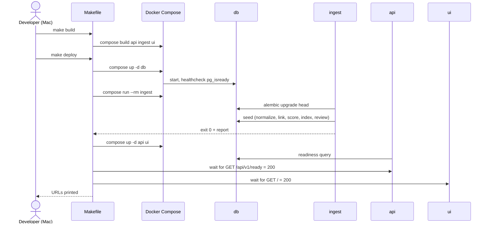

Failure: any non-zero exit stops `make deploy` and prints `make logs` hint. `make undeploy` runs `compose down -v --remove-orphans`.

## CF-02 Seed ingestion of one investigation

```mermaid
sequenceDiagram
  participant CLI as flamescope-ingest
  participant SEED as seed.py
  participant NORM as normalizer
  participant LINK as linker / loader
  participant SCORE as score_stage
  participant ORCH as AgentOrchestrator
  participant GW as LLMGateway
  participant EMB as embedder
  participant DB as PostgreSQL
  CLI->>SEED: load <acronym>.yaml + overrides
  SEED->>NORM: card (validated as InvestigationCard)
  NORM->>LINK: canonical card
  LINK->>DB: upsert project, hardware, investigation, fuels, runs, conditions, measurements, publications, findings
  CLI->>SCORE: score(acronym)
  alt scores present in seed
    SCORE->>DB: upsert relevance_score (origin seed)
  else missing
    SCORE->>ORCH: run("scorer", payload) per lens
    ORCH->>GW: ADK Runner runs scorer LlmAgent on gateway model
    GW-->>ORCH: values + evidence
    SCORE->>DB: upsert relevance_score (origin llm)
  end
  CLI->>EMB: index(acronym)
  EMB->>GW: embed(chunks)
  EMB->>DB: upsert chunks
  CLI->>DB: insert ingest_run report
```

## CF-03 Harvest ingestion of one investigation

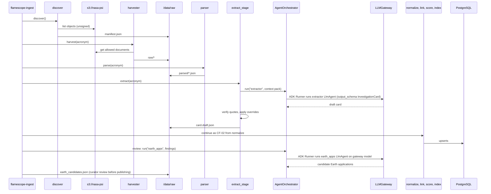

## CF-04 Explorer: list and detail

Endpoints: `GET /investigations`, `GET /facets`, `GET /investigations/{id}`, `GET /investigations/{id}/runs`, `GET /investigations/{id}/variables`. LLM: none.

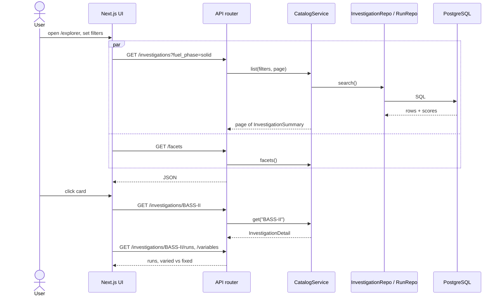

## CF-05 Ranking

Endpoint: `POST /rank`. LLM: none.

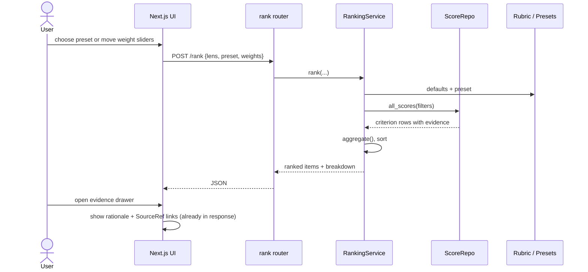

The UI debounces slider changes (250 ms) and keeps previous data while refetching.

## CF-06 Compare

Endpoint: `POST /compare`. LLM: optional.

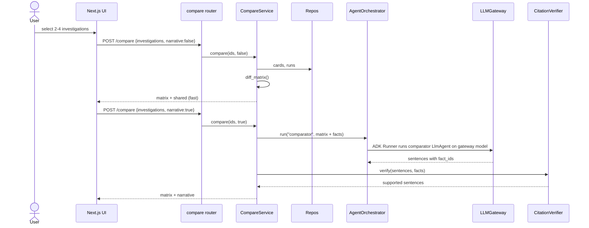

Failure: LLM error gives `narrative.status = "unavailable"`; UI shows the matrix and a muted notice.

## CF-07 Scenario Lab

Endpoint: `POST /scenario`. LLM: optional.

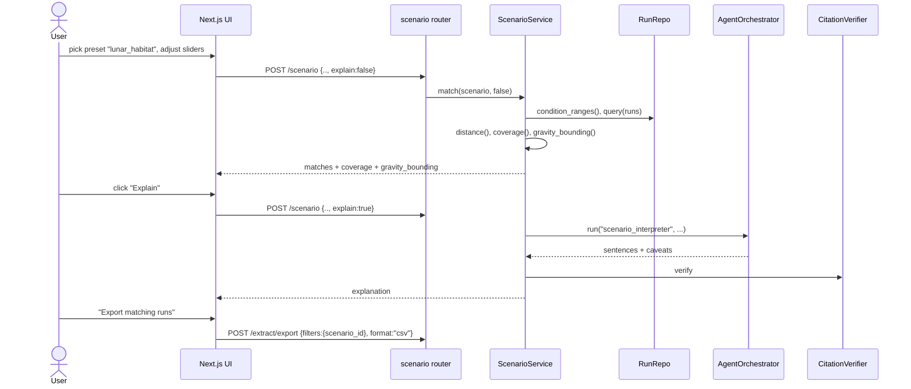

`scenario_id` is stateless: the URL-safe base64 encoding of the canonical scenario JSON (document 05 section 7). `ExtractService` decodes it to the scenario values and recomputes the matching runs, so no server-side registry is kept and the id survives restarts and multiple workers. Failure: an LLM error gives `explanation.status = "unavailable"`; a malformed `scenario_id` is HTTP 400 `bad_request`.

## CF-08 Data extract

Endpoints: `GET /extract/dictionary`, `POST /extract/preview`, `POST /extract/export`. LLM: none.

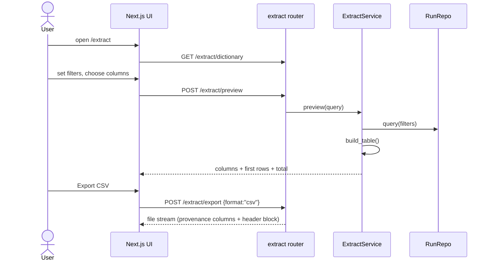

## CF-09 Ask (cited question answering)

Endpoint: `POST /ask` (SSE). LLM: yes.

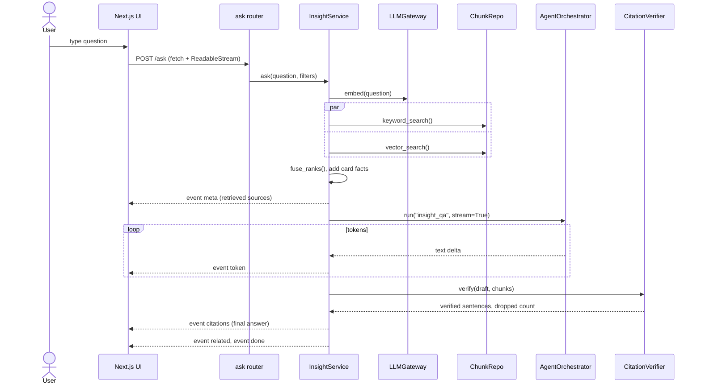

Failure: gateway error after `meta` produces `event: error`; the UI keeps the retrieved sources visible. No retrieval hits: fixed insufficient-information sentence, no LLM call.

## CF-10 Safety Tech, gaps and Earth applications

Endpoints: `GET /insights/safety-tech`, `GET /insights/gaps`, `GET /earth-applications`. LLM: none.

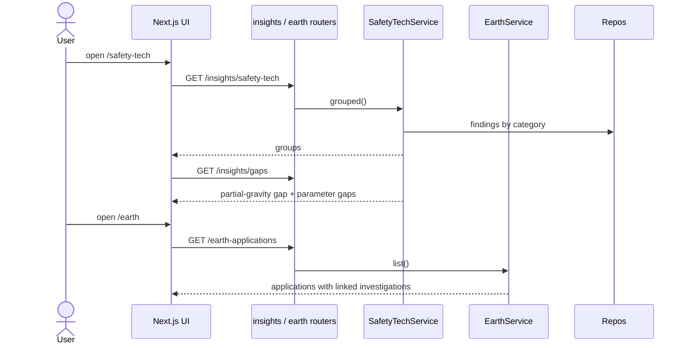

## CF-11 Overview page

Endpoints: `GET /meta/stats`, `POST /rank` (lens `overall`, limit 5), `GET /insights/gaps`, `POST /extract/preview` (columns `o2_fraction`, `pressure_kpa`, `fuel_phase`, `investigation`; limit 1000 for the coverage scatter, the `POST /extract/preview` maximum). Requests run in parallel; each panel has its own loading and error state. LLM: none.

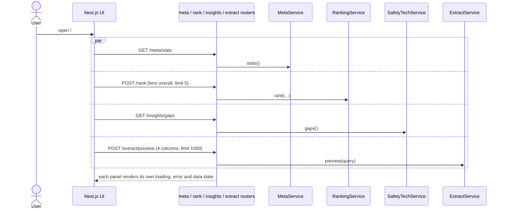

## CF-12 Architecture page with live status

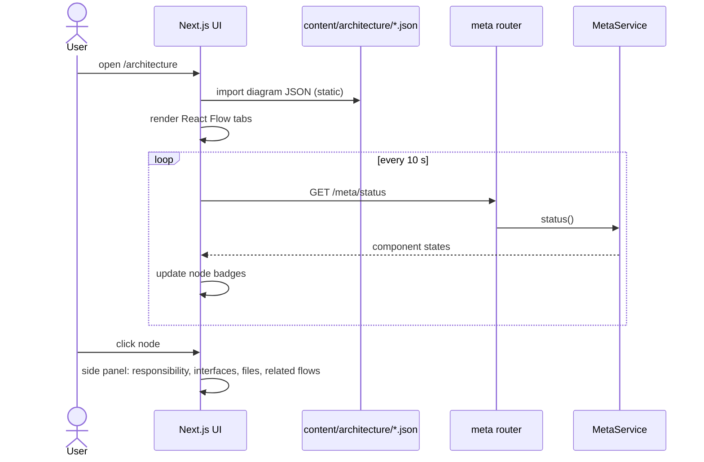

## CF-13 Undeploy

`make undeploy` -> `docker compose -p flamescope down -v --remove-orphans` -> containers, network and volumes removed. `make clean` additionally removes images and local caches. LLM: none.

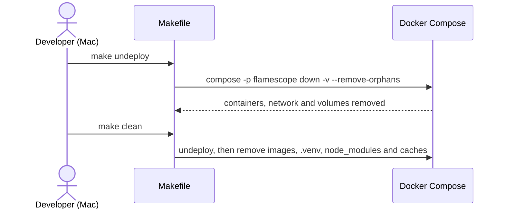
