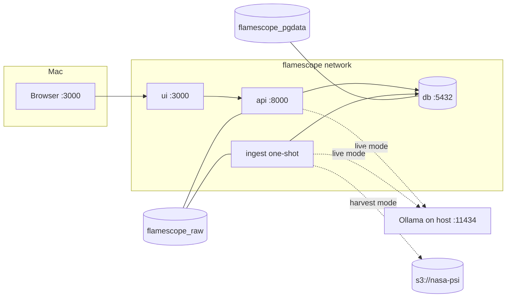

# 11 - Deployment and Operations

Reference host: macOS (Apple Silicon or Intel) with Docker Desktop or Colima, Docker Compose v2, GNU Make (the stock macOS make 3.81 must work), Python 3.12, Node 20 or newer for local UI work, and Ollama installed natively with `qwen2.5:0.5b` and `nomic-embed-text` pulled (live LLM mode, the default; `make ollama-pull`).

## 1. Containers

| Service | Dockerfile | Base | Runs | Health check |
|---------|------------|------|------|--------------|
| `db` | (image) `pgvector/pgvector:pg16` | - | PostgreSQL | `pg_isready -U $POSTGRES_USER -d $POSTGRES_DB` |
| `api` | `deploy/docker/Dockerfile.api` | `python:3.12-slim` multi-stage | `uvicorn flamescope_api.main:create_app --factory --host 0.0.0.0 --port 8000` | `GET /api/v1/health` |
| `ingest` | `deploy/docker/Dockerfile.ingest` | `python:3.12-slim` multi-stage | entrypoint: `flamescope-ingest migrate && flamescope-ingest $INGEST_COMMAND` | exit code |
| `ui` | `deploy/docker/Dockerfile.ui` | `node:20-alpine` multi-stage, Next.js standalone | `node server.js` on 3000 | `GET /` |

Image rules: multi-stage builds; non-root user (uid 10001); no build tools in the final stage; `.dockerignore` excludes `.git`, `node_modules`, `.venv`, `tests`, `docs`, `prompts`; images build for the host architecture (`linux/arm64` on Apple Silicon, `linux/amd64` on Intel) with no architecture-specific pins. Tags: `flamescope-api:local`, `flamescope-ingest:local`, `flamescope-ui:local`.

`Dockerfile.api` and `Dockerfile.ingest` copy `pyproject.toml`, `src/common`, `src/agents`, and their own package; `ingest` and `api` both include `src/data`.

## 2. Compose

File: `deploy/docker/compose.yaml`, project name `flamescope`, env file `../../.env`.

- `db`: volume `flamescope_pgdata`; port `127.0.0.1:${DB_PORT:-5432}:5432`.
- `ingest`: `profiles: ["job"]`; `depends_on: db (service_healthy)`; volume `flamescope_raw:/data/raw`.
- `api`: `depends_on: db (service_healthy)`; port `${API_PORT:-8000}:8000`; volume `flamescope_raw:/data/raw:ro`.
- `ui`: `depends_on: api (service_healthy)`; port `${UI_PORT:-3000}:3000`; env `API_INTERNAL_URL=http://api:8000`.
- `api` and `ingest`: `extra_hosts: ["host.docker.internal:host-gateway"]` so both reach Ollama on the Mac host under Docker Desktop and Colima. Ollama is not a compose service.

## 3. Configuration

`.env.example` is committed; `.env` is not. All variables:

| Variable | Default | Used by | Meaning |
|----------|---------|---------|---------|
| `POSTGRES_USER` / `POSTGRES_PASSWORD` / `POSTGRES_DB` | `flamescope` / `flamescope` / `flamescope` | db | Database bootstrap. |
| `DATABASE_URL` | `postgresql+psycopg://flamescope:flamescope@db:5432/flamescope` | api, ingest | SQLAlchemy URL. |
| `LLM_PROVIDER` | `ollama` | api, ingest | `mock` or `ollama`. `Settings` falls back to `mock` when unset; the test harness forces `mock`. |
| `OLLAMA_BASE_URL` | `http://host.docker.internal:11434` | gateway | Ollama on the Mac host (`http://localhost:11434` for local development without containers). |
| `LLM_MODEL` | `qwen2.5:0.5b` | gateway | Ollama chat model. |
| `LLM_TIMEOUT_S` | `60` | gateway | |
| `EMBED_PROVIDER` | same as `LLM_PROVIDER` | gateway | `mock` or `ollama`. |
| `EMBED_MODEL` | `nomic-embed-text` | gateway | Ollama embedding model; its dimension must equal `EMBED_DIM`. |
| `EMBED_DIM` | `768` | migrations, gateway | Vector dimension. |
| `PSI_BUCKET` / `PSI_REGION` / `PSI_PREFIX` | `nasa-psi` / `us-west-2` / empty | ingest | Harvest source. |
| `HARVEST_MAX_DOC_MB` / `HARVEST_MAX_TABLE_MB` / `HARVEST_MAX_TABLES` / `HARVEST_MAX_TOTAL_MB` | `25` / `5` / `20` / `300` | ingest | Download limits. |
| `INGEST_COMMAND` | `seed` | ingest | Entrypoint command. |
| `RAW_DIR` | `/data/raw` | api, ingest | Raw volume mount. |
| `DATA_DIR` | `/app/src/data` | api, ingest | Seed, rubric, presets. |
| `VERIFY_MIN_OVERLAP` | `0.35` | agents | Citation verifier threshold. |
| `CORS_ORIGINS` | `http://localhost:3000` | api | |
| `LOG_LEVEL` | `INFO` | all | |
| `API_INTERNAL_URL` | `http://api:8000` | ui | Rewrite target. Next.js fixes the rewrite at build time, so in the container it is a build argument of `Dockerfile.ui` (default `http://api:8000`, passed by compose); `npm run dev` reads it at runtime. |
| `API_PORT` / `UI_PORT` / `DB_PORT` | `8000` / `3000` / `5432` | compose | Host ports. |

## 4. Makefile targets (binding names)

| Target | Action |
|--------|--------|
| `help` | Default target; lists targets with descriptions. |
| `doctor` | Checks docker, compose, python3.12, node, free ports and, when `LLM_PROVIDER=ollama`, that Ollama answers at `OLLAMA_BASE_URL` with `LLM_MODEL` and `EMBED_MODEL` pulled; prints versions. |
| `ollama-pull` | `ollama pull $(LLM_MODEL)` and `ollama pull $(EMBED_MODEL)` on the host. |
| `env` | Creates `.env` from `.env.example` if missing. |
| `venv` | Creates `.venv` and installs `-e ".[dev]"`. |
| `ui-install` | `npm ci` in `src/ui`. |
| `lint` | ruff, mypy, xenon (complexity thresholds, document 02 section 3), eslint, tsc. |
| `fmt` | ruff format, prettier. |
| `build` | `docker compose build` for api, ingest, ui. |
| `deploy` | `env`, verify Ollama and its models when `LLM_PROVIDER=ollama` (fail with the `make ollama-pull` hint), start db, wait healthy, run ingest job (migrate + seed), start api and ui, wait for readiness, print URLs. |
| `ingest-seed` | Re-run seed ingestion. |
| `ingest-harvest` | Run harvest ingestion (requires `LLM_PROVIDER=ollama`). |
| `status` | `docker compose ps` plus `/ready` and `/meta/stats` summary. |
| `logs` | Tail logs (`SERVICE=api` optional). |
| `restart` | Restart api and ui. |
| `undeploy` | `docker compose down -v --remove-orphans`. |
| `clean` | `undeploy` plus remove local images, `.venv`, `node_modules`, caches. |
| `test-unit` | pytest `tests/unit` and `npm test` (Vitest). No Docker needed. |
| `test-integration` | pytest `tests/integration` (builds, deploys, verifies APIs; leaves stack running). |
| `test-e2e` | pytest `tests/e2e` with Playwright against the running stack. |
| `test` | `test-unit`, `test-integration`, `test-e2e`, then `undeploy` verification. |
| `all` | `build`, `deploy`, `test`. |
| `open` | `open http://localhost:$(UI_PORT)`. |
| `helm-template` / `helm-deploy` / `helm-undeploy` | Optional Kubernetes path (section 6). |

Makefile rules: `.PHONY` for all targets; `SHELL := /bin/bash`; variables overridable from the environment; `COMPOSE := docker compose -p flamescope -f deploy/docker/compose.yaml --env-file .env`; no GNU Make 4-only features; wait loops implemented with `curl` and a timeout (default 120 s) in `deploy/scripts/wait-for.sh`.

## 5. Operations

- **Bring-up order**: db, ingest job, api, ui (CF-01).
- **Readiness**: `/api/v1/ready` returns 200 only after migrations and at least one investigation exist.
- **Logs**: JSON on stdout; `make logs SERVICE=api`.
- **LLM modes**: the default is `LLM_PROVIDER=ollama` with `qwen2.5:0.5b` on the host's Ollama (`make ollama-pull` once). For the deterministic offline mode set `LLM_PROVIDER=mock` and `EMBED_PROVIDER=mock` in `.env`; to try another Ollama model set `LLM_MODEL`; then `make restart`. If the embedding model or dimension changes, re-index with `docker compose -p flamescope -f deploy/docker/compose.yaml --env-file .env --profile job run --rm ingest index --force` (documented in the README).
- **Data reset**: `make undeploy && make deploy`.
- **Demo safety**: keep a known-good stack in mock mode; LLM mode badge in the UI shows which mode is live.

## 6. Optional Helm chart

`deploy/helm/flamescope/` for Kubernetes or OpenShift: Deployments `api` and `ui`, StatefulSet `db` with PVC, Job `ingest` (Helm hook post-install, post-upgrade), PVC `raw`, ConfigMap (non-secret settings), Secret (DB password), Services, Ingress or OpenShift Route (`route.enabled`), NetworkPolicy. `values.yaml` keys mirror the variables in section 3 (`llm.provider`, `llm.ollamaBaseUrl`, `llm.model`, `embed.dim`, `ingest.command`, `image.*`, `route.host`). Containers run as non-root with no fixed UID requirement so the restricted OpenShift SCC applies.

## 7. Local development without containers

`make venv ui-install`, then `docker compose up -d db`, `flamescope-ingest migrate && flamescope-ingest seed` with `DATABASE_URL` pointing to `localhost`, `uvicorn flamescope_api.main:create_app --factory --reload`, and `npm run dev` in `src/ui` with `API_INTERNAL_URL=http://localhost:8000`.
